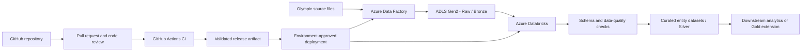
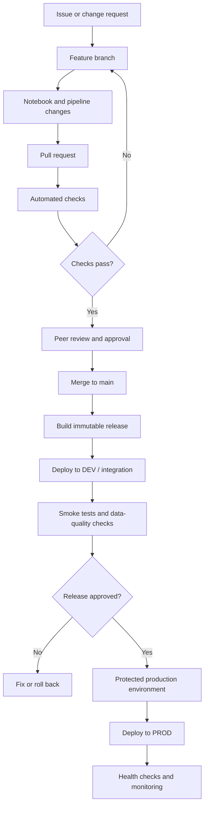

# Olympic Games Lakehouse on Azure

An end-to-end data engineering portfolio project built around **Azure Data Factory (ADF), Azure Data Lake Storage Gen2 (ADLS Gen2), Azure Databricks, Apache Spark, and GitHub-based CI/CD**. The project organizes Olympic Games data into entity-oriented processing flows for athletes, coaches, events, and National Olympic Committees (NOCs).

> **Implementation accuracy:** The repository contains entity-processing notebook artifacts. The architecture and production deployment sections distinguish the existing project scope from recommended production extensions. A README or notebook alone cannot prove the current state of Azure resources, ADF triggers, identity assignments, monitoring, or deployed CI/CD. Mark a capability as implemented only after verifying it in the Azure portal and repository.

## Contents

- [Executive summary](#executive-summary)
- [Business problem](#business-problem)
- [Architecture](#architecture)
- [End-to-end data flow](#end-to-end-data-flow)
- [Data layers and entity model](#data-layers-and-entity-model)
- [Repository guide](#repository-guide)
- [Azure services and responsibilities](#azure-services-and-responsibilities)
- [Data quality and reliability](#data-quality-and-reliability)
- [Security and governance](#security-and-governance)
- [GitHub workflow and production CI/CD](#github-workflow-and-production-cicd)
- [Production deployment strategy](#production-deployment-strategy)
- [Operations, monitoring, and recovery](#operations-monitoring-and-recovery)
- [Real-world production scenarios](#real-world-production-scenarios)
- [Runbook](#runbook)
- [Production-readiness checklist](#production-readiness-checklist)
- [Interview guide](#interview-guide)
- [References](#references)

## Executive summary

The solution separates **orchestration, storage, and distributed processing**:

- **Azure Data Factory** coordinates ingestion and pipeline dependencies.
- **ADLS Gen2** provides durable cloud storage for source and processed datasets.
- **Azure Databricks / Apache Spark** performs scalable transformations using notebooks.
- **Entity-level processing** organizes Olympic data around athletes, coaches, events, and NOCs.
- **GitHub** provides source control and, in the proposed production model, pull-request checks and deployment automation through GitHub Actions.

This design provides a foundation for repeatable ingestion, curated datasets, controlled releases, and downstream analytics. Gold-layer analytics, alerting, automated tests, and multi-environment deployment should be described as implemented only when the corresponding assets and configuration are present.


## Verified implementation snapshot and review findings

The repository contains more than notebooks: it also includes ADF pipeline, dataset, linked-service, and factory JSON artifacts, plus a Databricks curated-pipeline YAML and a generated job-definition Python file. The observations below are based on those committed artifacts, not a live inspection of Azure runtime settings.

### What is represented in the repository

- **ADF `GitToBronze`:** reads a JSON configuration from the lake, iterates over its `value` entries, fetches public GitHub raw CSV URLs, and writes Parquet files to parameterized Bronze destinations. The committed `Resources/param.json` lists athletes, coaches, and events.
- **ADF `DatalakeIngestion`:** lists items in a configured storage location and has a conditional copy branch for `nocs.csv` into a Bronze NOC folder. The non-matching branch appends file names to an array; the current JSON does not show a subsequent copy activity consuming that array.
- **Databricks Silver notebooks:** read Bronze Parquet/CSV data, perform entity transformations, and write Delta outputs to Silver storage and tables.
- **Curated pipeline:** `Olympics_dab/Curated_DLT/Cureted_DLT.yml` defines a pipeline named `Curated_DLT`, configured with catalog `olympics`, schema `gold_cur`, and a workspace notebook path. `Curated_Entities.ipynb` reads Silver tables and defines curated tables/views and data expectations.
- **Events/coaches job definition:** `Job_Events_&_Coaches.py` defines a task that runs the parameter notebook, then loops over its returned values to invoke the coaches/events notebook with widget parameters.

### High-priority items to verify or fix before calling this production-ready

| Priority | Evidence in committed artifacts | Why it matters / recommended action |
|---|---|---|
| **P0 — credentials and configuration hygiene** | The exported ADLS linked-service JSON includes an `encryptedCredential` metadata block; factory JSON includes tenant/principal identifiers; notebooks and datasets contain a fixed storage account URL. | Treat exported credential material as environment-bound. Verify no usable secrets are present in Git history, remove credential payloads from source control where not required, rotate any actual exposed secret, and parameterize account names and paths per environment. |
| **P1 — ingestion coverage** | `DatalakeIngestion` copies only the matching `nocs.csv` branch; the non-matching branch only appends file names to an array, and no later activity uses that array in the committed pipeline JSON. | If the intent is to copy every file, add and validate the missing dynamic copy path. If NOC-only behavior is intentional, rename/document the pipeline so its scope is clear. |
| **P1 — rerun safety** | Silver entity notebooks write using `.mode("append")`. | Re-running a notebook can append the same source records again. Define business keys and use a tested overwrite, deduplication, or Delta MERGE strategy appropriate to the data contract. |
| **P1 — athlete filter semantics** | `Silver_Entity_Atheletes.ipynb` creates `df_filtered` for a list of athletes, but later transformations and the final write use `df` / `df_sorted`, not `df_filtered`. | Confirm whether this is intended exploratory code or a business filter. If filtering is required, make the final data path use the filtered DataFrame and add a test. |
| **P1 — CDC sequencing** | The curated pipeline calls `dlt.apply_changes` for athletes with key `athelete_id`, SCD type 1, and `sequence_by = col("height")`. | Height is not normally a reliable change sequence because it is not a monotonic update timestamp/version. Use a true source update timestamp or ingestion sequence, and verify the key spelling and source/target schema. |
| **P1 — workspace-specific deployment** | The DLT YAML and generated job definition reference absolute `/Workspace/Olympics/...` paths; the job script also resets a hardcoded job ID. | These references can fail in another workspace. Move workspace-dependent values into deployment configuration and manage jobs/pipelines as versioned deployable resources. |
| **P2 — data-quality expectations** | Curated code defines DLT expectations for coach, NOC, and event records, while the athlete change flow has a separate configuration. | Confirm expectations are attached to the intended tables and decide whether each rule should warn, drop invalid records, or fail the pipeline. Monitor dropped/invalid record counts. |
| **P2 — retry and observability** | ADF pipeline activities currently define zero retries in the committed JSON; the GitHub copy activity logging is configured at warning level with reliable logging disabled. | Select retry policies for transient failures, enable useful diagnostic logging, and add alerts and run-level reconciliation without retrying deterministic schema/permission failures. |

These are static-review findings. They do not prove the current live factory or workspace has the same settings, and they do not mean a suggested fix has already been applied.


## Business problem

Olympic datasets are related but can arrive as separate files with different schemas and quality characteristics. A useful data platform needs to:

1. Land source files reliably and retain a recoverable raw copy.
2. Process multiple entities without mixing unrelated transformation logic.
3. validate schema, keys, duplicates, nulls, and entity relationships.
4. Make reruns safe when a pipeline fails or the same source is received twice.
5. Track pipeline health and identify which stage failed.
6. Release code safely without manually editing production notebooks or pipeline definitions.

The project demonstrates the core Azure data engineering pattern. The production design below extends that pattern with environment isolation, validation gates, controlled deployment, and operational recovery.

## Architecture

### Logical architecture



**How to read this diagram**

- The upper path is the data plane: data moves from source files through orchestration and transformation to curated outputs.
- The lower path is the delivery plane: code changes are reviewed, validated, and deployed independently of normal data processing.
- The diagram is a target logical architecture. Confirm the actual ADF activities, linked services, storage locations, and CI/CD workflows in the deployed environment before claiming every connection is live.

### Responsibility boundaries

| Area | Primary responsibility | Avoid using it for |
|---|---|---|
| ADF | Scheduling, dependencies, orchestration, retries, and activity-level monitoring | Replacing Spark for large distributed transformations |
| ADLS Gen2 | Durable file storage and separation of raw and processed data | Storing secrets or relying on folder names alone as access control |
| Databricks | Spark transformations, validation, and scalable data processing | Hardcoding environment-specific secrets and paths in notebooks |
| GitHub | Version control, branches, pull requests, code review, release history | Holding credentials in committed workflow files |
| GitHub Actions | Automated validation and controlled deployment | Deploying untested changes directly to production |
| Entra ID / managed identities / service principals | Authentication and authorization | Broad permanent permissions that exceed workload needs |

### Medallion-style data organization

| Layer | Goal | Olympic example | Recommended control |
|---|---|---|---|
| **Bronze / Raw** | Preserve received source data | Original athletes, coaches, events, and NOC files | Capture source name, arrival time, and run ID |
| **Silver / Curated** | Standardize and validate entity data | Cleaned entity datasets with consistent types and keys | Schema checks, deduplication, null rules, relationship checks |
| **Gold / Analytics-ready** | Serve business metrics and reporting | Medal summaries, participation by country, event trends | Business definitions, aggregation tests, documented refresh rules |

The notebook names indicate entity-level and curated processing. A Gold layer is a recommended extension unless a corresponding implementation can be identified in the repository or workspace. The physical storage format and write mode should be confirmed from notebook code and runtime configuration.

## End-to-end data flow

1. **Source and ingestion:** Olympic source files are selected for processing. ADF can orchestrate copy/ingestion activities, parameterized datasets, and dependent activities when configured.
2. **Raw landing:** Store source data in an ADLS Gen2 landing/raw area. Retain the original input where feasible so processing can be repeated and defects investigated.
3. **Notebook execution:** ADF can invoke Databricks notebooks and pass parameters. The notebook should use those parameters for environment-specific paths and run settings rather than hardcoded values.
4. **Entity transformation:** Databricks processes the relevant entity—athletes, coaches, events, or NOCs—using Spark transformations.
5. **Quality gates:** Validate required columns, types, business keys, duplicate policy, null policy, and relationships before promoting output.
6. **Curated output:** Write the accepted dataset to the configured Silver/curated destination. Use a documented write strategy so reruns have predictable behavior.
7. **Downstream consumption:** Curated datasets can feed SQL analysis, dashboards, or a future Gold layer. Document a consumer only when it is configured.
8. **Monitoring and recovery:** Record pipeline run IDs, activity status, row counts, and errors. Retry transient failures, quarantine bad records where appropriate, and rerun only when writes are safe.

## Data layers and entity model

### Entity-oriented processing

| Entity | Typical data-engineering concerns |
|---|---|
| Athletes | Stable athlete identifier, required attributes, duplicate profiles, valid country/NOC references |
| Coaches | Identity consistency, missing attributes, relationships to teams or NOCs where available |
| Events | Event naming, event identifiers, category consistency, duplicate event rows |
| NOCs | Standardized country/NOC codes, descriptive attributes, uniqueness, valid joins from other entities |

These are validation examples, not claims about the exact columns in the source files. Confirm the real schema in the notebook and source data.

### Recommended write semantics

Choose write behavior based on the data contract:

- **Overwrite:** suitable when the destination represents a complete reproducible snapshot and replacement is intentional.
- **Append:** suitable for immutable new records or event-style data when duplicates are handled.
- **Upsert / Delta MERGE:** suitable when stable keys and update semantics are defined and the target uses Delta Lake.
- **Quarantine:** retain malformed or rejected records with a reason and run ID instead of silently dropping them.

Do not add MERGE or claim incremental loading without confirming the business key, change semantics, and target format.

## Repository guide

The repository includes ADF JSON artifacts and these Databricks notebook artifacts:

| File | Purpose suggested by filename |
|---|---|
| `Array_Parameter.ipynb` | Returns a list of source/sink/folder parameters for the Databricks job's For Each task |
| `Curated_Entities.ipynb` | Curated entity processing |
| `Silver_Entities_Coaches&events.ipynb` | Coaches and events processing |
| `Silver_Entities_NOCS.ipynb` | NOC processing |
| `Silver_Entity_Atheletes.ipynb` | Athlete processing |

Filenames are shown as they appear in the repository. Verify notebook paths, exact transformations, source schemas, output paths, and write modes in the code and ADF pipeline configuration.

ADF configuration currently includes `pipeline/DatalakeIngestion.json`, `pipeline/GitToBronze.json`, linked-service and dataset JSON, `factory/dev-olympics-anuj.json`, and `publish_config.json`. Databricks artifacts include `Olympics_dab/Curated_DLT/Cureted_DLT.yml` and `Job_Events_&_Coaches.py`. A production-ready repository can grow to include:

```text
.
├── notebooks/                  # Entity transformation notebooks
├── tests/                      # Transformation and data-quality tests
├── adf/                        # Exported ADF artifacts / ARM templates
├── databricks.yml              # Declarative Automation Bundle, if adopted
├── resources/                  # Bundle job and pipeline definitions
├── .github/
│   └── workflows/              # GitHub Actions validation and deployment
├── scripts/                    # Validation and deployment helpers
└── README.md
```

This is a recommended structure, not a statement that every directory currently exists.

## Azure services and responsibilities

| Service | Role | Validate in the environment |
|---|---|---|
| Azure Data Factory | Orchestration and scheduling | Pipeline activities, dependencies, parameters, triggers, retry/timeout policies |
| ADLS Gen2 | Source and curated storage | Filesystem/container, paths, hierarchical namespace, permissions, retention |
| Azure Databricks | Spark notebook execution | Workspace, runtime, notebook paths, job settings, compute policies |
| Microsoft Entra ID | Identity management | The exact identity used by each workload |
| Managed identity / service principal | Service-to-service authentication | Role assignments, permissions, credential rotation or federation setup |
| Unity Catalog, if configured | Data governance | Catalogs, schemas, grants, storage credentials, external locations |
| Azure Key Vault, if configured | Secret management | Access policies/RBAC and secret references; never commit secret values |

**Important:** Workspace access does not automatically grant data-plane access to every ADLS path. Diagnose permissions using the identity actually used by the failing activity or notebook.

## Data quality and reliability

Build quality checks around explicit rules:

- **Schema:** required columns exist and data types are compatible.
- **Completeness:** mandatory keys and business attributes are not unexpectedly null.
- **Uniqueness:** entity keys do not contain unintended duplicates.
- **Validity:** values conform to known formats or allowed domains.
- **Referential integrity:** joins between entities do not unexpectedly lose records.
- **Reconciliation:** compare source, accepted, rejected, and output counts.
- **Schema drift:** detect new, removed, or incompatible columns and decide whether to accept, reject, or quarantine them.
- **Idempotency:** retries do not create unintended duplicates or corrupt prior output.
- **Auditability:** capture run ID, source file, processing time, status, counts, and error details.

Treat these as production controls to implement and test; do not imply that a control is already present unless the code or environment demonstrates it.

## Security and governance

1. Use managed identity or a dedicated service principal where supported.
2. Apply least privilege to storage, workspace, deployment, and production resources.
3. Keep tokens, client secrets, connection strings, and account keys out of notebooks and Git history.
4. Prefer GitHub Actions OIDC/workload identity federation when the Azure and Databricks identity configuration supports it, avoiding long-lived credentials in repository secrets.
5. Separate development and production workspaces/resources and restrict who can deploy to production.
6. Use protected GitHub environments, required reviewers, branch protection, and limited workflow permissions.
7. Store sensitive operational settings in approved secret stores; use GitHub environment variables only for non-secret configuration.
8. Audit identity and permission changes and review them periodically.

## GitHub workflow and production CI/CD

This section describes a **recommended deployment model**, not a claim that GitHub Actions workflows are already configured in this repository. It intentionally uses GitHub and GitHub Actions—not Azure DevOps.

### Branching and promotion strategy



**Suggested branch policy**

- `feature/*`: isolated development.
- Pull request into `main`: review, static checks, notebook validation, and automated tests.
- `main`: integration-ready code; production deployment should still pass explicit environment and approval gates.
- Release tags such as `v1.0.0`: optional immutable release markers for traceability.

For a small portfolio, keep the workflow proportionate. Introduce staging and manual production approval before using real production data or schedules.

### CI: validate before deployment

Recommended pull-request checks:

1. Validate JSON syntax for exported notebook and pipeline files.
2. Confirm notebooks are parseable and do not contain accidentally committed credentials.
3. Run Python unit tests for reusable transformation functions where practical.
4. Run data-quality tests against small, synthetic fixtures.
5. Validate the Databricks bundle configuration if the project adopts Declarative Automation Bundles.
6. Review changes to ADF pipeline definitions and environment-specific parameters.
7. Block deployment when validation fails.

Not every notebook can be meaningfully tested without a Spark runtime and representative input. Separate fast static checks from integration tests that require Azure resources.

### CD: deploy ADF and Databricks as separate asset types

**ADF deployment path**

- Keep ADF JSON definitions and the required deployment templates in version control.
- Validate the exported ADF artifacts.
- Deploy the approved template to the target factory using an authenticated Azure deployment step.
- Supply environment-specific values at deployment time instead of embedding development resource names in the template.
- Handle triggers deliberately during releases: stop only the affected triggers when required, deploy, verify, and restart them after a successful release.
- Run a post-deployment smoke test and check pipeline status.

ADF artifact export and template generation must match the actual repository setup. Do not assume that notebook files alone are a deployable ADF release.

**Databricks deployment path**

- Keep notebook/source code and job or pipeline definitions under version control.
- For a bundle-based deployment, define resources and targets in `databricks.yml`.
- Run bundle validation before deployment.
- Deploy to a development or integration target first; run tests and a smoke test.
- Promote the same reviewed source revision to production with production-specific configuration.
- Prefer workload identity federation/OIDC with a dedicated deployment service principal over a user's personal access token where supported.
- Use least-privilege workspace permissions and protected GitHub environments.

Databricks Declarative Automation Bundles are a recommended way to define and deploy supported Databricks resources as code. If the project uses notebooks only today, bundle adoption is a production enhancement rather than an existing capability.

### GitHub Actions workflow outline

The following is an **illustrative pipeline design**, not a ready-to-run workflow for this repository. Before enabling deployment, add and validate the actual ADF artifacts, Databricks bundle, target workspace settings, Azure federation configuration, and tests.

```yaml
name: Olympic Lakehouse CI

on:
  pull_request:
    branches: [main]
  push:
    branches: [main]

permissions:
  contents: read

jobs:
  validate:
    runs-on: ubuntu-latest
    steps:
      - name: Checkout
        uses: actions/checkout@v4

      - name: Set up Python
        uses: actions/setup-python@v5
        with:
          python-version: "3.11"

      - name: Validate notebook JSON
        run: |
          python - <<'PY'
          import json
          from pathlib import Path

          notebooks = list(Path(".").rglob("*.ipynb"))
          for path in notebooks:
              with path.open(encoding="utf-8") as file:
                  notebook = json.load(file)
              assert "cells" in notebook, f"Invalid notebook: {path}"
          print(f"Validated {len(notebooks)} notebook files")
          PY

      - name: Run unit tests
        run: |
          if [ -d tests ]; then
            python -m pip install pytest
            pytest -q
          else
            echo "No tests directory found; add automated tests before production promotion."
          fi
```

This validation example intentionally does not deploy anything. A production workflow should add separate deployment jobs that use OIDC, environment-specific approval, and the real project artifacts. Pin third-party actions to full commit SHAs in a hardened production workflow and update those pins through a controlled process.

### Production release controls

| Control | Why it matters |
|---|---|
| Protected main branch | Prevents unreviewed changes from becoming release candidates |
| Required CI checks | Stops invalid code or configuration before deployment |
| Environment approval | Makes production releases explicit and auditable |
| OIDC / workload federation | Reduces dependence on long-lived secrets |
| Immutable commit or tag | Makes the deployed version traceable |
| Dev/integration smoke test | Catches configuration and permission failures early |
| Post-deployment health check | Confirms that deployed resources can execute |
| Rollback plan | Defines how to restore a known-good version |
| Deployment concurrency control | Avoids overlapping releases modifying the same resources |
| Audit trail | Connects PR, commit, workflow run, deployment, and pipeline run |

### Rollback strategy

- **Code rollback:** redeploy the last known-good commit or release artifact.
- **ADF rollback:** redeploy the last validated factory template and restore the intended trigger state.
- **Databricks rollback:** redeploy the last known-good bundle/source revision.
- **Data rollback:** code rollback alone does not restore changed data. Use a deliberate recovery plan—such as rerunning from retained raw data, restoring a known-good Delta version where applicable, or rebuilding affected curated outputs.
- **After rollback:** verify data quality, output counts, pipeline health, and downstream consumers before resuming normal schedules.

## Production deployment strategy

### Environment separation

| Concern | Development | Test / integration | Production |
|---|---|---|---|
| Purpose | Fast iteration | Validate end-to-end behavior | Serve trusted workloads |
| Data | Synthetic or limited sample | Representative and controlled | Approved operational data |
| Deployment | Feature branches and PR checks | Automated candidate deployment | Protected approval gate |
| Identity | Developer or dev workload identity | Dedicated test identity | Dedicated least-privilege identity |
| Triggers | Manual or limited | Controlled test schedule | Explicitly approved schedule |
| Monitoring | Developer feedback | Release validation | Alerts, runbooks, audit history |

Use configuration per environment for workspace host, factory name, storage paths, catalog/schema, compute settings, and schedule. Keep secrets out of source control. Avoid promoting a developer's workspace state manually as the release process.

### Production-grade pipeline pattern

1. **Ingest:** ADF starts the run and records a run identifier.
2. **Land:** source files are retained in the raw area.
3. **Validate:** verify file presence, schema, and basic record counts.
4. **Transform:** Databricks processes the required entities.
5. **Quality gate:** validate keys, duplicates, required fields, relationships, and reconciliation.
6. **Publish:** update curated destinations only after required checks pass.
7. **Observe:** record metrics, errors, and duration; notify the appropriate owner when a run fails.
8. **Recover:** rerun from a known checkpoint or raw input using idempotent write behavior.
9. **Release safely:** source changes pass CI, are deployed to a lower environment, and receive approval before production promotion.

### Performance and cost controls

- Use job-oriented compute and auto-termination where suitable; avoid leaving interactive compute running unnecessarily.
- Select only required columns and filter early when semantically correct.
- Avoid collecting large datasets to the driver.
- Inspect Spark plans and execution metrics before changing partitioning or cluster size.
- Avoid blindly increasing workers or shuffle partitions.
- Use retry policies for transient failures, not to mask deterministic schema or permission errors.
- Schedule pipelines according to data arrival and business need.
- Review Azure Cost Management for Databricks compute, storage, networking, and other resources.
- Use lifecycle policies for retained files only after defining audit and recovery requirements.

## Operations, monitoring, and recovery

| Symptom | Investigate | Response |
|---|---|---|
| ADF cannot connect to a source or sink | Linked service, integration runtime, network, identity | Inspect activity error details; validate connectivity and authentication |
| Databricks cannot read ADLS | ABFSS path, filesystem, credential, role/ACL | Identify the runtime identity and verify required data access |
| Write returns access denied | Data-plane role assignment or directory ACL | Grant only the required access to the correct identity |
| Parquet/Spark type mismatch | Physical file type, inferred schema, schema drift | Inspect the failing column; apply explicit, justified casts or a controlled schema |
| Duplicate output after retry | Append semantics, missing key, non-deterministic transformation | Define a business key and make writes idempotent |
| Pipeline succeeds but output is missing | Sink path, conditions, notebook parameters, write mode | Compare activity inputs/outputs and verify the target path |
| One entity fails while others succeed | Dependencies, per-entity validation, error handling | Isolate the failed entity and define whether the whole release must fail |
| Unexpected cloud spend | Idle compute, triggers, networking, storage | Inspect Cost Management, job schedules, compute state, and network resources |
| Deployment succeeds but run fails | Runtime permissions, parameters, artifact paths | Run a smoke test using the deployed identity and configuration |

For each production run, aim to capture: pipeline run ID, commit/release ID, start/end time, source files, row counts, rejected counts, output destination, status, and actionable error details.

## Real-world production scenarios

### Scenario 1 — A source file introduces a new column

**Risk:** transformation failure or silent loss of information.

**Response:** preserve the raw file, detect schema drift, compare the incoming schema with the expected contract, and explicitly accept, transform, or quarantine the change. Add a regression test for the new schema.

### Scenario 2 — The same file is delivered twice

**Risk:** duplicate athletes, events, or inflated metrics.

**Response:** record file identity or a suitable source key, define the business key and write semantics, deduplicate deterministically, and make reruns idempotent. Use Delta MERGE only when supported by the target model and defined key logic.

### Scenario 3 — A failure occurs after raw ingestion but before curation

**Risk:** the next run repeats work or publishes incomplete output.

**Response:** keep stages observable, retain raw inputs, use explicit ADF dependency conditions, and publish curated outputs only after validation passes. Ensure the downstream stage can be safely rerun.

### Scenario 4 — NOC and athlete records do not match

**Risk:** records disappear in joins or reporting shows incorrect country attribution.

**Response:** measure unmatched keys and join cardinality, validate code formats, retain or quarantine unmatched rows according to a documented policy, and fail the quality gate when agreed thresholds are exceeded.

### Scenario 5 — A production deployment changes notebook parameters

**Risk:** production reads development data or writes to the wrong storage path.

**Response:** parameterize environment settings, validate required parameters, use protected environment configuration, and perform a post-deployment smoke test against the expected workspace and storage destination.

### Scenario 6 — A GitHub Actions deployment credential is exposed

**Risk:** unauthorized changes to data resources.

**Response:** prefer OIDC/workload federation, minimize workflow permissions, use a dedicated service principal, rotate/revoke any exposed credential, review audit logs, and investigate the affected resources. Never commit credentials to repair a pipeline.

### Scenario 7 — A production release passes CI but fails at runtime

**Risk:** syntax tests pass while real Azure permissions or data shape are incompatible.

**Response:** deploy to an integration environment first, run a representative integration test and a small data-quality check, verify runtime identity and parameters, and block production promotion until the release passes.

### Scenario 8 — Processing volume grows significantly

**Risk:** longer runtime, skew, memory pressure, and increased cost.

**Response:** inspect Spark execution metrics, skew, shuffle volume, file sizes, and query plans. Optimize based on measurements, and define service-level expectations for runtime and freshness.

## Runbook

### Before a run

1. Verify source availability and expected file names.
2. Confirm ADF parameters, linked services, and target paths.
3. Confirm the correct identity has required storage and workspace permissions.
4. Verify the target write mode and whether the run is safe to retry.
5. Check that the intended environment is selected.

### After a run

1. Inspect ADF activity status and notebook output.
2. Confirm expected output files or tables exist.
3. Compare source, accepted, rejected, and output row counts.
4. Check schema, key uniqueness, and required fields.
5. Review warnings, failures, and processing duration.
6. Record the run result and release/commit reference.
7. Investigate failed quality gates before promoting data to downstream consumers.

### Recovery

1. Identify the failed stage and determine whether it is a code, data, permission, network, or compute issue.
2. Preserve error details and the original source input.
3. Decide whether a retry is safe; do not repeatedly retry deterministic failures.
4. Fix the underlying issue and validate the change in a lower environment.
5. Rerun the smallest safe scope.
6. Reconcile outputs and notify affected consumers if published data was incomplete.

## Production-readiness checklist

### Data platform
- [ ] Document exact ADF pipeline names, activity dependencies, triggers, and parameters.
- [ ] Document raw and curated paths, file formats, and schema contracts.
- [ ] Add schema, null, uniqueness, relationship, and reconciliation checks.
- [ ] Define write semantics, deduplication, and idempotent rerun behavior.
- [ ] Add run-level audit metadata and failure alerts.
- [ ] Define retry, timeout, quarantine, and recovery rules.

### Security
- [ ] Confirm the exact identity used by each workload.
- [ ] Apply least-privilege storage and workspace permissions.
- [ ] Remove secrets from source code and Git history.
- [ ] Configure approved secret management and/or workload federation.
- [ ] Separate production access from developer access.

### GitHub CI/CD
- [ ] Add protected branches and required pull-request checks.
- [ ] Add notebook/configuration validation and automated tests.
- [ ] Keep ADF deployment artifacts and Databricks definitions versioned.
- [ ] Define environment-specific configuration without hardcoded secrets.
- [ ] Use GitHub Actions with minimal permissions and OIDC where supported.
- [ ] Protect production environment with approval rules.
- [ ] Add deployment smoke tests, auditability, and rollback procedures.
- [ ] Test the full workflow in a non-production environment before production use.

### Operations and cost
- [ ] Configure useful run monitoring and actionable alerts.
- [ ] Review compute sizing, auto-termination, schedules, and storage lifecycle.
- [ ] Define expected data freshness and acceptable run duration.
- [ ] Test recovery from a failed transformation and a failed deployment.


**Project status:** Azure data engineering portfolio project. Confirm live resource configuration and deployment automation before describing them as production-deployed.
